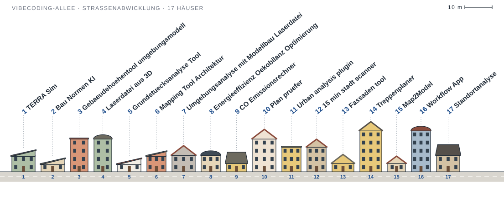

# Vibecoding KI-Werkstatt · Jade Hochschule

Wahlpflichtkurs „Thinking Architecture through Software Design“.
Studierende aus Architektur und Urban Design bauen in einer Blockwoche
eigene digitale Werkzeuge – mit KI-Agenten wie Claude Code und Codex.

## Projekte
Jedes Repository hier ist ein Projekt aus der Blockwoche 16.–20.11.2026.
Die README im Projekt erklärt, was das Tool kann und wie man es startet.

<!-- PROJEKTE:START – wird automatisch erzeugt (scripts/build.mjs), bitte nicht von Hand ändern -->

<b><a href="https://jade-hs-vibecoding-wpk.github.io/.github/">Rundgang durch die Vibecoding-Allee →</a></b> 
Jedes Projekt ist ein Haus: Jede Verdopplung der Commits bringt ein Geschoss, die Fassade zeigt die Programmiersprache. Neue Repos ziehen automatisch ein.

| Nr. | Projekt | Worum geht’s | Team |
|---:|---|---|---|
| [1](https://jade-hs-vibecoding-wpk.github.io/.github/#TERRA-Sim) | [**TERRA-Sim**](https://github.com/Jade-HS-Vibecoding-WPK/TERRA-Sim) | Ein interaktives Web-Tool zur automatischen Generierung von 3D-Stadtmodellen (LOD 1–2) und zur heuristischen Simulation von Umweltkatastrophen (Hochwasser, Starkregen, Starkwind). · [Live-Demo](https://jade-hs-vibecoding-wpk.github.io/TERRA-Sim/) |  |
| [2](https://jade-hs-vibecoding-wpk.github.io/.github/#ParaGecko) | [**ParaGecko**](https://github.com/Jade-HS-Vibecoding-WPK/ParaGecko) | ParaGecko findet die Paragraphen zu jedem Grundstück: Bau- und Denkmalrecht (BauGB, Landesbauordnungen, Denkmalschutzgesetze, VOB) im amtlichen Wortlaut und eine Ortsauskunft zu Bebauungsplänen und Kulturdenkmalen für jede Adresse in Deutschland. Forschungsprojekt im WPK, Nutzung nur privat und nicht gewerblich. · [Live-Demo](https://jade-hs-vibecoding-wpk.github.io/ParaGecko/) |  |
| [3](https://jade-hs-vibecoding-wpk.github.io/.github/#gebaeudehoehentool-umgebungsmodell) | [**gebaeudehoehentool-umgebungsmodell**](https://github.com/Jade-HS-Vibecoding-WPK/gebaeudehoehentool-umgebungsmodell) | Höhen und Geschosszahlen von Gebäuden in einem bestimmten Gebiet werden automatisch ermittelt, im gewählten Maßstab abgebildet und sind exportierfähig. · [Live-Demo](https://jade-hs-vibecoding-wpk.github.io/gebaeudehoehentool-umgebungsmodell/) |   |
| [4](https://jade-hs-vibecoding-wpk.github.io/.github/#laserdatei-aus-3D) | [**laserdatei-aus-3D**](https://github.com/Jade-HS-Vibecoding-WPK/laserdatei-aus-3D) | Anhand eines 3D-Modells wird eine Laserdatei erstellt · [Live-Demo](https://jade-hs-vibecoding-wpk.github.io/laserdatei-aus-3D/) |  |
| [5](https://jade-hs-vibecoding-wpk.github.io/.github/#Grundstuecksanalyse-Tool) | [**Grundstuecksanalyse-Tool**](https://github.com/Jade-HS-Vibecoding-WPK/Grundstuecksanalyse-Tool) | Standortanalyse mit Karte, über 60 Analyse-Ebenen (Fußwege, Sonne, ÖPNV, Einrichtungen, Grün, Lärm, Boden, Bodenrichtwerte, Zensus und mehr), eigener Plan, Fotos, Dateien und Zeichnen, Grundstücksanalyse, 3D-Ansicht mit Schatten und Sonnenstunden, Schnitt, Entwurfsstrategie als Text. Projekt sichern und Export als PNG, PDF, DXF und SVG · [Live-Demo](https://jade-hs-vibecoding-wpk.github.io/Grundstuecksanalyse-Tool/Standortanalyse/) |  |
| [6](https://jade-hs-vibecoding-wpk.github.io/.github/#SiteKick) | [**SiteKick**](https://github.com/Jade-HS-Vibecoding-WPK/SiteKick) | Ein Tool entwickeln, das Lagepläne, Schwarzpläne, 3D-Gebäude daten, Straßen und Grünflächen/Vegetation automatisch erfasst, übersichtlich darstellt und Zusammenfasst · [Live-Demo](https://jade-hs-vibecoding-wpk.github.io/SiteKick/) |    |
| [7](https://jade-hs-vibecoding-wpk.github.io/.github/#Modellbau-Laserdatei-Gebaeude) | [**Modellbau-Laserdatei-Gebaeude**](https://github.com/Jade-HS-Vibecoding-WPK/Modellbau-Laserdatei-Gebaeude) | Erstellt anhand von einer IFC-Datei mit Gebäuden eine fertige DXF-Laserdatei, wo das Darstellen von Fenstern und Türen berücksichtigt wird · [Live-Demo](https://jade-hs-vibecoding-wpk.github.io/Modellbau-Laserdatei-Gebaeude/) |   |
| [8](https://jade-hs-vibecoding-wpk.github.io/.github/#Energieeffizienz-Oekobilanz-Optimierung) | [**Energieeffizienz-Oekobilanz-Optimierung**](https://github.com/Jade-HS-Vibecoding-WPK/Energieeffizienz-Oekobilanz-Optimierung) | Ein bestehendes Projekt, egal ob bereits fertiggestellt oder noch in der Entwurfsphase, analysieren und Anpassungs-bzw. Optimierungsvorschläge für Bauweise sowie Materialwahl herausgeben, um eine höhere Energieeffizienz und bessere Ökobilanz zu erzielen. · [Live-Demo](https://jade-hs-vibecoding-wpk.github.io/Energieeffizienz-Oekobilanz-Optimierung/) |  |
| [9](https://jade-hs-vibecoding-wpk.github.io/.github/#CO-Emissionsrechner) | [**CO-Emissionsrechner**](https://github.com/Jade-HS-Vibecoding-WPK/CO-Emissionsrechner) | CO2- und Ökobilanz-Rechner bei den Materialien eines Entwurfes und Alternativmaterialien vorgeschlagen werden. · [Live-Demo](https://jade-hs-vibecoding-wpk.github.io/CO-Emissionsrechner/) |   |
| [10](https://jade-hs-vibecoding-wpk.github.io/.github/#plan-pruefer) | [**plan-pruefer**](https://github.com/Jade-HS-Vibecoding-WPK/plan-pruefer) | Ein Tool, das Baupläne auf Vollständigkeit und Richtigkeit prüft · [Live-Demo](https://jade-hs-vibecoding-wpk.github.io/plan-pruefer/) |   |
| [11](https://jade-hs-vibecoding-wpk.github.io/.github/#urban-analysis-plugin) | [**urban-analysis-plugin**](https://github.com/Jade-HS-Vibecoding-WPK/urban-analysis-plugin) | Ein PlugIn für QGIS, das Daten sammelt, diese zusammenführt, bereinigt und auf Dopplungen prüft und als letzten Schritt erste Analysen ausgibt. |   |
| [12](https://jade-hs-vibecoding-wpk.github.io/.github/#15-min-stadt-scanner) | [**15-min-stadt-scanner**](https://github.com/Jade-HS-Vibecoding-WPK/15-min-stadt-scanner) | Stadt in 15 Minuten – 15-Minuten-Stadt-Scanner für die städtebauliche Standortanalyse: Klick auf die Karte zeigt, was zu Fuß in 5 und 10 Minuten erreichbar ist (echte Fußwege, OpenStreetMap). Oldenburg + Großstädte Niedersachsens · Export als PNG, PDF A3 und GeoPackage. WPK Vibecoding, Jade Hochschule. · [Live-Demo](https://jade-hs-vibecoding-wpk.github.io/15-min-stadt-scanner/) |  |
| [13](https://jade-hs-vibecoding-wpk.github.io/.github/#fassaden-tool) | [**fassaden-tool**](https://github.com/Jade-HS-Vibecoding-WPK/fassaden-tool) | Grundriss hochladen, dann verschiedene Fassadenmaterialitäten ausprobieren und vergleichen, auch Öffnungsmaße · [Live-Demo](https://jade-hs-vibecoding-wpk.github.io/fassaden-tool/) |  |
| [14](https://jade-hs-vibecoding-wpk.github.io/.github/#treppenplaner) | [**treppenplaner**](https://github.com/Jade-HS-Vibecoding-WPK/treppenplaner) | Web-App zur Berechnung und Auswahl von Treppen nach DIN 18065 · [Live-Demo](https://jade-hs-vibecoding-wpk.github.io/treppenplaner/) |  |
| [15](https://jade-hs-vibecoding-wpk.github.io/.github/#Map2Model) | [**Map2Model**](https://github.com/Jade-HS-Vibecoding-WPK/Map2Model) | Eine Software, die eine automatisch bearbeitbare 3D Datei erstellt, das Hinzufügen eigener Neubauten ermöglicht und passgenaue Laserdateien für den Architekturmodellbau generiert. · [Live-Demo](https://jade-hs-vibecoding-wpk.github.io/Map2Model/) |  |
| [16](https://jade-hs-vibecoding-wpk.github.io/.github/#Workflow_App) | [**Workflow_App**](https://github.com/Jade-HS-Vibecoding-WPK/Workflow_App) | Eine Web-App fürs Handy (PWA), die beim Zeit- und Aufgabenmanagement hilft: Tages-, Wochen- und Monatsplan, Aufgaben, Ziele mit Unterzielen – und eine Projektplanung nach der … · [Live-Demo](https://jade-hs-vibecoding-wpk.github.io/Workflow_App/) |  |
| [17](https://jade-hs-vibecoding-wpk.github.io/.github/#Detailpruefer) | [**Detailpruefer**](https://github.com/Jade-HS-Vibecoding-WPK/Detailpruefer) | Detailprüfer (Web-App, die Bauteilaufbauten wie Wand, Dach oder Boden auf Plausibilität prüft: Schichtenfolge, Dämmstärken, U-Wert, Tauwasserrisiko und Anschlussdetails. Fehler werden markiert und Verbesserungen vorgeschlagen) |  |
| [18](https://jade-hs-vibecoding-wpk.github.io/.github/#locus) | [**locus**](https://github.com/Jade-HS-Vibecoding-WPK/locus) | LOCUS. – Web-App zur Standortanalyse für jeden Ort in Deutschland: Mobilität, Grün und Gebäudenutzungen als Layer im Maßstab 1:500–1:5.000, Defizitanalyse mit Steckbrief und PDF-Export. Auf Basis von OpenStreetMap. Studienprojekt Architektur, Jade Hochschule. · [Live-Demo](https://jade-hs-vibecoding-wpk.github.io/locus/) |    |
| [19](https://jade-hs-vibecoding-wpk.github.io/.github/#ImmoCheck) | [**ImmoCheck**](https://github.com/Jade-HS-Vibecoding-WPK/ImmoCheck) | ImmoCheck: Wirtschaftlichkeitsprüfung für Immobilien im Browser (Kaufcheck, Bestandsverwaltung, Karte, Bodenrichtwert) · [Live-Demo](https://jade-hs-vibecoding-wpk.github.io/ImmoCheck/) |  |
| [20](https://jade-hs-vibecoding-wpk.github.io/.github/#urban-analyst) | [**urban-analyst**](https://github.com/Jade-HS-Vibecoding-WPK/urban-analyst) | QUAVA macht aus einem frei gewählten Stadtausschnitt in Deutschland in wenigen Minuten fertige städtebauliche Analysepläne, die man in Illustrator oder CAD weiterbearbeiten kann. · [Live-Demo](https://jade-hs-vibecoding-wpk.github.io/urban-analyst/) |   |
| [21](https://jade-hs-vibecoding-wpk.github.io/.github/#MaterialMatch) | [**MaterialMatch**](https://github.com/Jade-HS-Vibecoding-WPK/MaterialMatch) | MaterialMatch – Baustoffvergleich und Match-Funktion für Architektur · [Live-Demo](https://jade-hs-vibecoding-wpk.github.io/MaterialMatch/) |  |
| [22](https://jade-hs-vibecoding-wpk.github.io/.github/#niedersachsen-cache) | [**niedersachsen-cache**](https://github.com/Jade-HS-Vibecoding-WPK/niedersachsen-cache) | Niedersachsen-Cache: vorberechnete OpenStreetMap-Daten für die Großstädte Niedersachsens (+ Randgebiete) auf GitHub Pages – schnell statt Overpass-Warteschlange · [Live-Demo](https://jade-hs-vibecoding-wpk.github.io/niedersachsen-cache/) |  |
| [23](https://jade-hs-vibecoding-wpk.github.io/.github/#Jade-Werkbank) | [**Jade-Werkbank**](https://github.com/Jade-HS-Vibecoding-WPK/Jade-Werkbank) | Die Werkbank am Ende der Vibecoding-Allee: alle Projekte als Werkzeuge, dazu eine Ablage zum Zwischenspeichern von Dateien · [Live-Demo](https://jade-hs-vibecoding-wpk.github.io/Jade-Werkbank/) |   |

23 Projekte · Liste aktualisiert sich automatisch alle 20 Minuten. Die Nummer führt direkt zum Haus in der Straße.
<!-- PROJEKTE:END -->

## Für Teilnehmende
- Repo-Name: `projektname` in Kleinbuchstaben, Wörter mit Bindestrich
- Abgabe: bis Freitag, 20.11.2026, 16 Uhr
- README mit: Was ist das Tool, Installation, Screenshot, Quellen & KI-Nutzung
- Keine API-Keys im Repo (`.env` gehört in `.gitignore`)
- Euer Repo zieht automatisch in die Straße ein. Die Kurzbeschreibung kommt aus
  dem Feld **About** (Zahnrad rechts oben im Repo), ein Link unter **Website**
  wird als Live-Demo verlinkt, das erste Bild der README erscheint als Screenshot.

## Team
Yara Hirsekorn · Nik Ansre
Prof. Dr.-Ing. Gregor Grunwald · Prof. Dr.-Ing. Radostina Radulova-Stahmer

Jade Hochschule Wilhelmshaven/Oldenburg/Elsfleth
